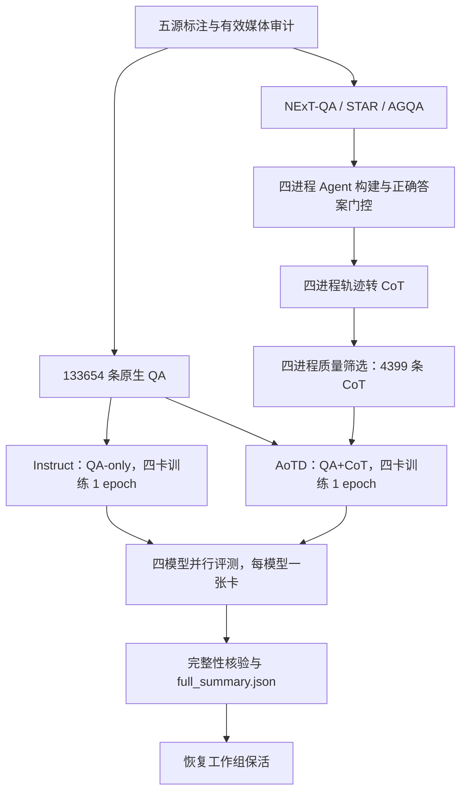

# 五源完整运行开发报告（2026-11-10）

本轮已完成五源有效数据准备、三源 CoT 构建、两轮完整训练和四组完整验证集评测。运行于 `2026-11-10T15:20:21Z` 正常结束，状态 `complete`、退出码 `0`、汇总 `PASS`。最终运行代码为 `65317ee4aba74f5ccf2360652b38c0a5aee43224`，部署时核对了 249 个跟踪文件。本次提交只整理文档与脱敏证据，不修改已经完成的实验代码或数据。

准确率、训练时间与研究限制单独记录在[结果报告](FULL_RUN_RESULTS_20261110.md)。历史修复及分阶段验证保留在[开发日志](DEVELOPMENT_LOG.md)，完成核验见[机器可读证据](../reproduction/evidence/full_run_20261110.json)。

## 1. 目标和完成范围

目标是提供可离线、可恢复、有节流进度输出的完整入口，实际验证后交付。采用 `five-source-valid-media-no-anetqa-v1` 协议：明确排除 ANetQA；EgoQA 排除 22 条已审计的缺失或不可解码媒体，其余有效样本全部使用。AGQA 为确定性重建的 25,000 条子集，不是整个原始 AGQA。

最终 QA 为 133,654 条，合格 CoT 为 4,399 条。原作者完整处理后训练池、抽样 ID 和 few-shot 示例未公开，因此本实现是五源工程重建，不能称为六源论文协议的严格复现。



两个训练实验按 Instruct → AoTD 依次执行，分别从同一个 Base 初始化；AoTD 不从本轮 Instruct 权重继续训练。评测还包含未训练 Base 与作者发布权重。

## 2. 修复与可靠性

| 问题 | 实现与验证 |
|---|---|
| 生成程序的数据错误被误判为基础设施故障 | 按最深 traceback 来源分类；生成程序错误可拒绝，真实模型/CUDA 错误仍停止并留证 |
| OWLv2 长查询超出上下文 | 从实际模型配置读取长度，显式截断并保留结束 token；97→16 token 的原失败查询真实前向通过 |
| 无效时间选择与裁剪进入视觉模型 | 模型调用前检查空片段、非有限坐标、倒置和无面积区域；不静默吞掉模型错误 |
| 构建、转换和筛选串行 | spawn 启动四个独立 worker，动态派发，父进程唯一写入 JSONL；每条 flush/fsync，最多重做四条未提交样本 |
| 评测按模型串行 | 四个独立模型各占一张工作卡并行，每模型保留自己的逐题恢复日志 |
| 训练和评测中断后重算 | 三层恢复：制数逐条 journal；训练模型/optimizer/scheduler/RNG；评测逐题 journal |
| 保存或发布中途退出 | checkpoint 完成标记原子提交；最新未完成断点回退；训练池先暂存校验、manifest 最后发布 |
| 借用空闲卡影响主任务 | 两个独立保活进程组，独立锁、作用域和 watchdog；借用组异常不清理工作组 |

训练默认每 100 个 optimizer step 保存一次完整 checkpoint，保留最近两份，最后一步额外保存。完整断点以 `aotd_checkpoint.json` 标识；恢复绑定数据、模型和配置指纹。最终导出使用 `training_complete.json`，已完成阶段再次启动会校验后复用。首次尚无完整断点的中断不能宣称无损恢复，按既有机制明确从 step 0 重启并保存现场。

## 3. 并行收益与验证边界

| 实测对照 | 串行 warm 时间 | 并行 warm 时间 | 吞吐提升 |
|---|---:|---:|---:|
| 构建，40 条真实样本 | 227.71 s | 71.95 s | 3.16× |
| 转换，64 条真实样本 | 218.38 s | 73.93 s | 2.95× |
| 筛选，1,024 条真实样本 | 60.59 s | 22.79 s | 2.66× |

以上输出逐条一致，属于指定样本实测，不代表整条流水线恒定加速比。构建含冷加载时间为 264.97→244.51 秒，仅 1.08×；短任务不能只看 warm 数字。证据分别见 `reproduction/evidence/parallel_*_benchmark.json`。

此前目标环境 77 项回归通过，并实际验证部分 journal 续接、训练 checkpoint 恢复、评测恢复、借卡任务退出 17 和借卡 guard 被 SIGKILL。此次未为纯文档更新重跑训练；追加核验了四组各 4,996 个唯一问题、逐题正确/无效/类别统计、跨模型 ID/标签/媒体哈希一致，以及两份最终训练标记、导出文件大小与 checkpoint 标记。

## 4. GPU 管理与运行命令

在已配置资源的项目目录运行：

```bash
bash run_aotd_full.sh --check
bash run_aotd_full.sh
```

默认复用最近一次受管理运行；本次已经完成，重复执行会验证并复用结果。需要重新训练和评测时显式使用 `bash run_aotd_full.sh --new-run`；这不会删除可兼容复用的制数记录。指定旧运行可用 `--resume /absolute/project/results/full_RUN`。

0–3 卡为工作组，4–7 卡为独立保活/借用组：

```bash
bash run_spare_task.sh -- bash /absolute/path/to/job.sh
tail -n 20 -F results/full_RUN/run.log
```

借卡任务逻辑设备 0–3 对应物理 4–7，任务应保留 wrapper 设置的设备可见性。工作任务结束恢复工作组，借卡结束恢复借用组；两组空闲时八卡保活。本次完成日志确认工作组恢复，随后实查两个 supervisor 和八个 worker 均存在且未暂停，八卡均有保活活动。CPU、内存、磁盘仍共享；节点或容器整体退出不由同容器 watchdog 保证恢复。

进度默认每 30 秒输出，可配置 10–60 秒，阶段完成立即输出。运行时只写日志和 JSON/JSONL，不持续写 Markdown。

## 5. 交付与集成

开发说明、独立结果报告及脱敏证据随 [PR #5](https://github.com/GentaLee/AoTD/pull/5) 提交，目标为 `integration/offline-reproduction`。原始逐题记录、媒体、教师权重、最终学生权重与完整训练断点留在持久化运行目录，不上传 Git。公开证据仅含必要的统计、版本和文件哈希，不含部署地址、机器名称或设备型号。

下一步研究应优先审计 CoT 质量和源分布、检查时间类退化并做多随机种子对照；本轮没有启动新的训练实验。
